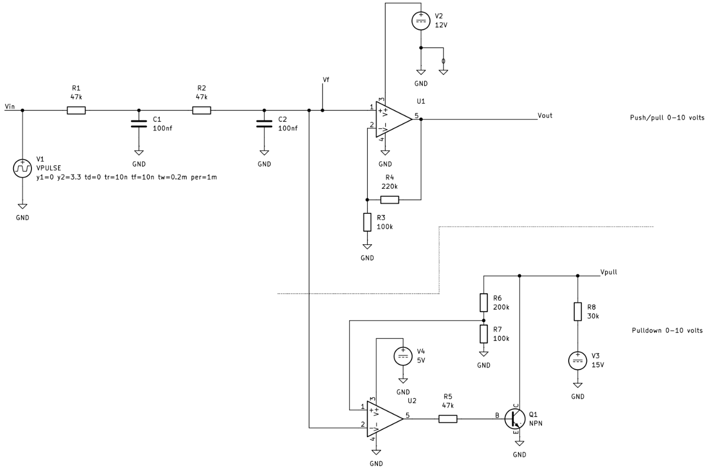

# Wireless 0-10 volt light dimmer

## Background

Some LED lights use a separate 0-10 volt DC signal to control their brightness. This project
eliminates running separate low voltage wire for this purpose. The original use case was a finished
garage where fluorescent tubes were replaced with UFO-style hanging LED fixtures. Fishing a hundred
feet of new wire behind drywall was not a serious option.

## Overview

The user chooses a dimming level via an EC11 rotary encoder driving an ESP32 that serves as an
ESP-NOW broadcast transmitter. Any number of other ESP32s configured as receiver convert the dimming
level to a PWM output that's low-pass filtered and voltage multiplied to 0-10 volts. Multiple
transmitters also work as you'd want them to.

This design does _not_ handle on/off by interrupting mains power. A separate switch is necessary for
that. These units are meant to be switched along with the lights. Non-volatile storage is used to
restore previous state.

Commercial products performing a similar function but lacking the multiple transmitters feature cost
about $80 for a transmitter/receiver pair and $53 for each additional receiver.

## Useful details

Transmitters and receivers run the same firmware. A GPIO pin (see dimmer.c for number) strapped to
ground makes the device a receiver, else it's a transmitter.

Pressing the rotary encoder's shaft pushbutton-style forces a broadcast in case any receiver falls
out of sync. Twisting it changes the dimming level.

For all nodes, the on-board LED flashes and then pauses continuously. The number of flashes, zero to
eight, reflects current dimming level, min to max.

### Security

Since ESP-NOW doesn't provide security, we need our own. The main threats are spoofing and playback.
To counter, broadcast payloads include a sequence number and SHA-256 signature based on payload data
concatenated with a secret key. Receivers check the signature and verify that sequence numbers are
ascending. All nodes checkpoint sequence numbers to NV storage and re-load them while rebooting.

## Parts required

The prototype uses a very inexpensive 30-pin dev board and 5-volt/mains power module bought on
Amazon. Since only 4 GPIO pins are needed, the tiny Seed Studio board would make smaller build. Its
external antenna would be an advantage. Indeed the 30-pin boards don't honor the ESP-32 hardware dev
guidance to keep the built-in antenna completely free of the PCB either by letting it hang over the
edge or placing it in a wide notch. Tx and rx signal transfer equate to max operating range.

### Transmitter

- ESP32-WROOM dev board. Prototype used [this basic ESP-32](https://www.amazon.com/dp/B0F1MS5S8R).
  Capabilities used:
  - 4 GPIO pins. See `dimmer.c` to re-configure.
  - On-board LED as level indicator.
  - Wifi ESP-NOW broadcast and receive.
  - Non-volatile storage for wifi and app state including level and payload sequence numbers.
- Lines voltage to 5v or 3.3v power source for ESP32. 500ma minimum. Used Hi-link PM-01.
- 1A fuse and varistor for surge protection. See Hi-link data sheet.
- EC11 rotary encoder

### Receiver

- ESP32-WROOM dev board. See transmitter Capabilities used:
  - 2 GPIO pins. See `dimmer.c` to re-configure.
  - On-board LED as level indicator.
  - Wifi ESP-NOW receive.
  - Non-volatile storage for wifi, persisting level and security info through power losses.
- Lines voltage to 12v or 5v power source. Used Hi-link PM-01.
- If 12v used, down-converter to 3.3v DC, 500ma minimum.
- Mis resistors and capacitors.
- LM358P op amp

### Receiver output circuit

The receiver output consists of a filter that transforms PWM to an analog voltage level between 0
and 3.3 volts. Following this is an op-amp stage that multiplies by 3 to provide the necessary 0-10
volt dimming signal. There are two variations.

The simplest option is a non-inverting circuit with the op amp powered by at least 12v DC. LM358P
can safely source 20ma and sink 10ma, which is likely to be enough. If more current is needed, use a
higher capacity part like OPA1656. A discrete pass transistor after the op amp is another
possibility.

Another option is available if the LED controller being driven only needs its input to be "pulled
together" from an existing differential of 10 or more volts toward zero. My LED's controller works
this way. The 0-10 volt input behaves as a 15 volt source in series with a ~100k resistor. Short
circuit (0 volt) current is therefore 0.15ma. By using a discrete pass transistor to do the pulling,
the op amp can use a 5 volt supply shared with the ESP32. My devices use this option. It works well.

This schematic shows the filter connected to both kinds of op amp output. Since the LM358 is a dual
device, both can be wired on the same board at little extra cost if desired. Of course if using a 5
volt VCC, the simple op amp circuit won't work correctly.

### Perf board construction

I built my prototypes on standard prototyping perf board to keep cost down. I essentially designed a
double-sided PCB on a 0.1 inch grid, made "traces" out of 24 gauge copper wire, and installed
components as usual. Neither power modules nor EC11 encoders fitted the grid exactly. Drilling extra
holes fixed that.

### PC Boards

I have draft PCB layouts for both TX and RX, which I did mainly to learn a bit of Kicad. For my app,
I'm settling for proto boards to keep costs down. If you're interested, please post an issue.

### Cases

3d printed case designs are in progress.
